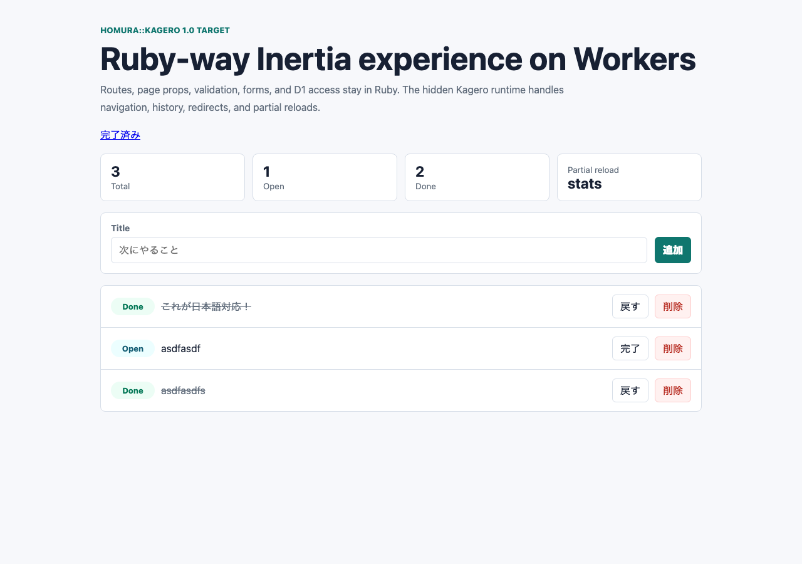

## はじめに

`sinatra-kagero`（Kagero）は、React・Vue・Svelteを書かずに、SinatraのrouteとRubyのPageクラスだけでSPA的な画面遷移を作るgemです。
route、props、入力の検証、HTMLはRubyで書きます。
ブラウザ側の`fetch`、履歴、DOMの差し替えは、gemに入っている小さなJS（以下、runtime）が受け持ちます。

<div class="kagero-attention">
  <p><strong>Cloudflare Workersで動かしています。</strong></p>
  <p>サンプルは、Sinatraを<a href="https://github.com/kazuph/homura">homura</a>（Opal）でCloudflare Workersに載せ、D1をデータベースに使っています。</p>
</div>



- RubyGems: <https://rubygems.org/gems/sinatra-kagero>
- GitHub: <https://github.com/kazuph/homura/tree/main/gems/sinatra-kagero>
- サンプル: <https://kagero-d1-todo.kazu-san.workers.dev/>

## Inertiaのpage objectを、Rubyで描く

[Inertia](https://inertiajs.com/)は、サーバーがJSONのAPIではなく「次のページ」を返す仕組みです。
ページは、どのcomponentをどのpropsで描くかを書いたJSONで、page objectと呼ばれます。
普通のInertiaでは、ブラウザ側のReactやVueのcomponentがこのJSONを受けて描きます。

Kageroはpage objectの形をそのまま使い、componentの描画だけをサーバーのRubyに戻します。
RubyのPageクラスがHTMLまで作り、そのHTMLを`props.kagero.html`に入れて返します。
サンプルの`/`にInertiaの要求を送ると、次のJSONが返ります（HTMLとtodosの一部を省略）。

<div class="kagero-code" data-label="サンプルが返すpage object" markdown="1">

```json
{
  "component": "Todos/Index",
  "props": {
    "flash": {},
    "todos": [
      {
        "id": 10,
        "title": "これが日本語対応！",
        "done": true,
        "created_at": 1782437916
      },
      "…"
    ],
    "stats": {
      "total": 3,
      "open": 1,
      "done": 2
    },
    "errors": {},
    "kagero": {
      "component": "Todos/Index",
      "html": "<style>…</style><section class=\"shell\"><header class=\"hero\">…",
      "title": "Kagero D1 Todo"
    }
  },
  "url": "/",
  "version": "kagero-1"
}
```

</div>

runtimeは、このJSONを受けて`<main>`の中身を差し替え、URLとタブのタイトルを書き換えるだけです。

## 1回のフォーム送信で起きること

TODOを1件追加するときの流れです。

<div style="overflow-x:auto; margin: 24px 0;">
<svg viewBox="0 0 900 600" style="width:100%; min-width:680px; height:auto; display:block;" role="img" aria-label="Kageroで1件追加するときの、ブラウザとサーバーのやり取りの図" xmlns="http://www.w3.org/2000/svg" font-family="system-ui, -apple-system, 'Hiragino Sans', sans-serif">
  <defs><marker id="kg-a" viewBox="0 0 10 10" refX="9" refY="5" markerWidth="8" markerHeight="8" orient="auto-start-reverse"><path d="M0,0 L10,5 L0,10 z" fill="#334155"/></marker></defs>
  <rect x="10" y="10" width="300" height="580" rx="14" fill="#eef4ff" stroke="#9db7e5"/>
  <text x="30" y="42" font-size="18" font-weight="800" fill="#172033">ブラウザ</text>
  <text x="30" y="64" font-size="13" fill="#475569">Kagero runtime（gem に同梱の JS）</text>
  <rect x="590" y="10" width="300" height="580" rx="14" fill="#effaf5" stroke="#9fd8bf"/>
  <text x="610" y="42" font-size="18" font-weight="800" fill="#172033">サーバー（Workers）</text>
  <text x="610" y="64" font-size="13" fill="#475569">Sinatra ＋ sinatra-kagero ＋ D1</text>
  <rect x="30" y="90" width="260" height="50" rx="10" fill="#fff" stroke="#cbd5e1"/>
  <text x="44" y="114" font-size="14" font-weight="800" fill="#172033">① / を普通に開く</text>
  <path d="M290,115 L606,115" stroke="#334155" stroke-width="2" fill="none" marker-end="url(#kg-a)"/>
  <text x="448.0" y="105" text-anchor="middle" font-size="13" font-weight="700" fill="#172033">GET /</text>
  <rect x="610" y="90" width="260" height="70" rx="10" fill="#fff" stroke="#cbd5e1"/>
  <text x="624" y="114" font-size="14"  fill="#172033">Index を描いた HTML に</text>
  <text x="624" y="134" font-size="14"  fill="#172033">page object と runtime を埋め込む</text>
  <path d="M606,150 L294,150" stroke="#334155" stroke-width="2" fill="none" marker-end="url(#kg-a)"/>
  <text x="450.0" y="140" text-anchor="middle" font-size="13" font-weight="700" fill="#172033">HTML ＋ XSRF-TOKEN の cookie</text>
  <rect x="30" y="210" width="260" height="70" rx="10" fill="#fff" stroke="#cbd5e1"/>
  <text x="44" y="234" font-size="14" font-weight="800" fill="#172033">② フォームを送信</text>
  <text x="44" y="254" font-size="14"  fill="#172033">runtime が送信を横取り</text>
  <path d="M290,245 L606,245" stroke="#334155" stroke-width="2" fill="none" marker-end="url(#kg-a)"/>
  <text x="448.0" y="235" text-anchor="middle" font-size="13" font-weight="700" fill="#172033">fetch POST /todos</text>
  <text x="448.0" y="265" text-anchor="middle" font-size="12" fill="#475569">X-Inertia ＋ X-XSRF-TOKEN</text>
  <rect x="610" y="205" width="260" height="190" rx="10" fill="#fff" stroke="#9fd8bf"/>
  <text x="624" y="229" font-size="14"  fill="#172033">CSRF: cookie とヘッダーを照合</text>
  <text x="624" y="249" font-size="14"  fill="#172033">　→ 違えば 403、D1 は変えない</text>
  <text x="624" y="269" font-size="14"  fill="#172033">Command で入力を検証</text>
  <text x="624" y="289" font-size="14"  fill="#172033">D1 に insert</text>
  <text x="624" y="309" font-size="14" font-weight="800" fill="#172033">redirect_page(&quot;/&quot;, Index, ...)</text>
  <text x="624" y="329" font-size="14"  fill="#172033">Index#call で HTML を描く</text>
  <text x="624" y="349" font-size="14"  fill="#172033">url を / にした page object</text>
  <text x="624" y="369" font-size="14"  fill="#172033">（JSON）を返す</text>
  <path d="M606,380 L294,380" stroke="#334155" stroke-width="2" fill="none" marker-end="url(#kg-a)"/>
  <text x="450.0" y="370" text-anchor="middle" font-size="13" font-weight="700" fill="#172033">page object（JSON）</text>
  <text x="450.0" y="400" text-anchor="middle" font-size="12" fill="#475569">component・props・kagero.html・url</text>
  <rect x="30" y="410" width="260" height="150" rx="10" fill="#fff" stroke="#cbd5e1"/>
  <text x="44" y="434" font-size="14" font-weight="800" fill="#172033">③ runtime が適用</text>
  <text x="44" y="454" font-size="14"  fill="#172033">page object の形を確かめる</text>
  <text x="44" y="474" font-size="14"  fill="#172033">&lt;main&gt; の HTML を差し替え</text>
  <text x="44" y="494" font-size="14"  fill="#172033">タブのタイトルを更新</text>
  <text x="44" y="514" font-size="14"  fill="#172033">pushState で URL を / に</text>
  <text x="44" y="534" font-size="14"  fill="#172033">（失敗なら画面上部に表示）</text>
</svg>
</div>

最初の表示だけは普通のHTMLです。
サーバーはPageを描いたHTMLに、page objectとruntimeを埋め込んで返します。
同時に、偽のフォーム送信を防ぐトークン（`XSRF-TOKEN`）をcookieに入れます。

2回目からは、runtimeがクリックと送信を横取りしてJSONでやり取りします。
送信が通ったら、サーバーは一覧ページを描き直して、URLを`/`にしたpage objectを返します。
POSTのあとに`/`へリダイレクトするのと同じ結果を、1往復で得られます。

## アプリ側のコード

### route

`register Sinatra::Kagero`したSinatraアプリです。
`page`でPageを返し、送信後は`redirect_page`で「次のページ」を返します。

<div class="kagero-code" data-label="examples/kagero-d1-todo/app/app.rb（抜粋）" markdown="1">

```ruby
class App < Sinatra::Base
  register Sinatra::Kagero
  # 設定とヘルパー（db・todos・todo_stats・index_page など）は省略

  get "/" do
    page(
      Pages::Todos::Index,
      todos: todos,
      stats: todo_stats,
      errors: page_errors || {},
      flash: flash_payload
    )
  end

  post "/todos" do
    command = Commands::CreateTodo.new(params)
    if command.valid?
      db[:todos].insert(title: command.title, done: 0, created_at: Time.now.to_i)
      if page_request?
        index_page(flash: {notice: "Todo added"})
      else
        set_flash(notice: "Todo added")
        redirect to("/"), 303
      end
    elsif page_request?
      index_page(errors: command.errors)
    else
      page_errors(command.errors)
      redirect to("/"), 303
    end
  end

  # GET /done、完了の切り替え、削除の route は省略
end
```

</div>

`page_request?`は、要求に`X-Inertia: true`ヘッダーが付いているか（runtimeからの要求か）を見ます。
`index_page`は`redirect_page("/", Pages::Todos::Index, ...)`を呼ぶヘルパーです。
runtimeからの要求なら一覧のpage objectをURL`/`で返し、それ以外でCSRFの検査を通った要求なら303で`/`へリダイレクトします。

### Page

画面は`Kagero::Page`で書きます。
`Kagero::Page`は[Phlex](https://www.phlex.fun/)の`Phlex::HTML`を継承していて、`h1 { "..." }`のようにRubyのメソッド呼び出しでHTMLを組み立てます。

<div class="kagero-code" data-label="examples/kagero-d1-todo/app/pages/todos/index.rb（抜粋）" markdown="1">

```ruby
module Pages
  module Todos
    class Index < Kagero::Page
      title "Kagero D1 Todo"

      props do
        prop :todos, Array
        prop :stats, Hash, required: false, default: -> { {} }
        prop :errors, Hash, required: false, default: -> { {} }
        prop :flash, Hash, required: false, default: -> { {} }
      end

      def view_template
        style { raw(safe(css)) }

        section(class: "shell") do
          header(class: "hero") do
            # 見出しと説明文（省略）
          end

          kagero_link(href: "/done") { "完了済み" }
          render_flash
          render_stats
          render_form
          render_list
        end
      end

      private

      # render_flash・render_stats は省略

      def render_form
        section(class: "panel", "aria-label": "Create TODO") do
          kagero_form(action: "/todos", method: "post", class: "new-form", "data-kagero-preserve-scroll": "true") do
            div(class: "field") do
              label(for: "title") { "Title" }
              input(
                id: "title",
                type: "text",
                name: "title",
                placeholder: "次にやること",
                "aria-invalid": field_error?(:title).to_s,
                "aria-describedby": field_error?(:title) ? "title-error" : nil
              )
              if field_error?(:title)
                p(id: "title-error", class: "error", role: "alert") { error_for(:title) }
              end
            end

            button(type: "submit", class: "button-primary") { "追加" }
          end
        end
      end

      # render_list・error_for・CSS などは省略
    end
  end
end
```

</div>

`props`は、Pageが受け取る値の宣言です。
宣言にない値は捨て、必須の値が無いときや型が違うときは例外にします。
`kagero_form`と`kagero_link`は、普通の`<form>`と`<a>`に`data-kagero`属性を付けるだけのヘルパーで、runtimeはこの属性を目印に送信とクリックを横取りします。

### Command

入力の検証もRubyです。

<div class="kagero-code" data-label="examples/kagero-d1-todo/app/commands/create_todo.rb（抜粋）" markdown="1">

```ruby
module Commands
  class CreateTodo < Kagero::Command
    attribute :title, String, default: ""

    validates_presence_of :title, message: "title_required"
    validates_length_of :title, maximum: 80, message: "title_too_long"

    def title
      @title.to_s.strip
    end
  end
end
```

</div>

検証に落ちると、routeは`errors`を入れた一覧のpage objectを返し、Pageが入力欄の下にエラーを描きます。


## gemの中身

### page helper

`page`と、runtimeからの要求を受けた`redirect_page`は、どちらも`render_kagero_page`に流れます。

<div class="kagero-code" data-label="gems/sinatra-kagero/lib/sinatra/kagero.rb（抜粋）" markdown="1">

```ruby
def render_kagero_page(page_class, props, url: request.fullpath)
  component = page_class.kagero_component_name
  page_instance = page_class.new(**props)
  page_props = page_instance.kagero_props
  body_html = page_instance.call

  response_props = page_props.merge(
    kagero: Sinatra::Inertia.always(
      {
        component: component,
        html: body_html,
        title: page_instance.kagero_title
      }
    )
  )

  if inertia_request?
    render_kagero_json(component, response_props, url)
  else
    render_kagero_shell(component, response_props, url)
  end
end
```

</div>

`page_instance.call`がPhlexのHTMLを作ります。
Inertiaの通信の部分（page objectの組み立て、asset versionの照合、部分更新）は、下の層の[sinatra-inertia](https://rubygems.org/gems/sinatra-inertia)が受け持ちます。
`kagero`を`always`で包む理由は、次の部分更新の節で説明します。

### runtime

runtimeの中心は`visit`です。
同じoriginの要求だけを送り、POSTなどには`XSRF-TOKEN`cookieの値を`X-XSRF-TOKEN`ヘッダーに入れます。
返ってきたJSONがKageroのpage objectの形をしているかを確かめてから、画面と履歴を書き換えます。

<div class="kagero-code" data-label="gems/sinatra-kagero/runtime/kagero.js（抜粋）" markdown="1">

```js
async function visit(url, options = {}) {
  const method = (options.method || "GET").toUpperCase();
  const targetUrl = new URL(url, location.href);
  if (targetUrl.origin !== location.origin) {
    if (method === "GET") location.href = targetUrl.href;
    else showFailure();
    return;
  }
  startLoading();
  const headers = new Headers(options.headers || {});
  headers.set("X-Inertia", "true");
  headers.set("X-Inertia-Version", currentPage ? currentPage.version : "");
  // X-Requested-With と Accept の設定（省略）

  if (!["GET", "HEAD", "OPTIONS"].includes(method)) {
    const cookie = document.cookie.split("; ").find((entry) => entry.startsWith("XSRF-TOKEN="));
    if (cookie) headers.set("X-XSRF-TOKEN", decodeURIComponent(cookie.slice("XSRF-TOKEN=".length)));
  }

  try {
    const response = await fetch(url, {
      method,
      body: options.body,
      headers,
      credentials: "same-origin",
      mode: "same-origin",
      redirect: "follow"
    });

    // 応答のorigin、409（asset versionの不一致）、失敗応答、page objectの形の検査、
    // 部分応答のpropsの重ね方（省略）

    rememberScroll();
    document.getElementById("kagero-visit-error")?.remove();
    applyPage(page, {
      replace: options.replace === true,
      preserveScroll: options.preserveScroll === true
    });
  } catch (error) {
    showFailure();
  } finally {
    finishLoading();
  }
}
```

</div>

`mode: "same-origin"`にしているので、途中で別のoriginへリダイレクトされると`fetch`自体が失敗し、トークンは外へ出ません。
失敗したときは画面の上に短いメッセージを出し、入力中の文字はそのまま残します。

runtimeの仕事はほかに、クリックと送信の横取り、戻る・進むでの画面の復元、通信中に画面上部へ出す細い線があります。
アプリを書く側が触るJSはありません。

## 部分更新

一覧の上の「Partial reload」ボタンは、統計（`stats`）を指定して部分更新を頼みます。

<div class="kagero-code" data-label="examples/kagero-d1-todo/app/pages/todos/index.rb（抜粋）" markdown="1">

```ruby
def render_stats
  section(class: "stats", "data-testid": "stats") do
    stat("Total", stat_value(:total))
    stat("Open", stat_value(:open))
    stat("Done", stat_value(:done))
    kagero_partial_button(only: :stats, class: "stat refresh", "aria-label": "Refresh stats") do
      span { "Partial reload" }
      strong { "stats" }
    end
  end
end
```

</div>

runtimeは、Inertiaの部分更新のヘッダー（`X-Inertia-Partial-Component: Todos/Index`と`X-Inertia-Partial-Data: stats`）を付けて同じURLを取り直します。
サーバーのrouteはいつもどおり一覧と統計の両方を取り、ページ全体のHTMLを描きます。
そのあとsinatra-inertiaが、応答に入れるpropsを`stats`に絞ります。

ここに落とし穴がありました。
1.0.2までは、画面のHTMLを入れた`kagero`も絞られて消え、runtimeは画面を書き換えませんでした。
サーバーは新しい件数を返しているのに、表示は変わらないままでした。
1.1.0では`kagero`をInertiaの`always`（部分更新でも必ず返すprop）にしたので、応答は`stats`と`kagero`になります。

つまりKageroの部分更新で減るのは、返すpropsのJSONだけです。
データベースへの問い合わせと描画はページ全体の分だけ走り、画面もページ全体が新しくなります。
返ってこなかったprops（この例では`todos`など）は、runtimeが前の値を残します。

## CSRFの守り

1.1.0から、サンプルはsinatra-inertiaのCSRFの守りを有効にしています。
サーバーは`XSRF-TOKEN`cookieを配り、POSTなどでは同じ値の`X-XSRF-TOKEN`ヘッダーを求めます。
一致しない要求は、routeに届く前に403で拒否し、D1には書き込みません。

ヘッダーを付けるのはruntimeなので、このサンプルのフォーム送信にはruntimeが要ります。
JavaScriptが動かない状態の普通のフォーム送信は403になり、routeの303の分岐には届きません。

## Turbo・Inertiaとの違い

| 名前 | 画面を描く場所 | 画面の更新 |
|---|---|---|
| Turbo | サーバーのHTML | ドキュメントやframeのHTMLを差し替える |
| Inertia | ブラウザのcomponent | page object（component＋props）を受けてcomponentで描く |
| Kagero | サーバーのRuby（Phlex） | page objectを受け、入っているHTMLで差し替える |

Hotwireに寄せるならHTML断片の差し替えになります。
Kageroはpage objectという形を残したまま、componentをRubyに置いています。
asset versionの照合や部分更新のように、Inertiaの通信の決まりをそのまま使えます。

## おわりに

Kageroは、Inertiaのpage objectの中身をRubyで描いたHTMLにしたgemです。
アプリはroute、Page、CommandをRubyで書き、ブラウザ側は送信・履歴・差し替え・CSRFヘッダーを受け持つruntimeだけで動きます。
1.1.0で部分更新とCSRFの守りが、公開サンプルでも動くようになりました。

Enjoy, Ruby-way Inertia!
