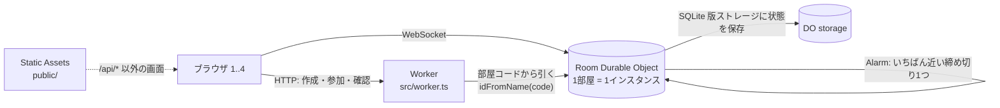

# 構成メモ

## 全体

## 選んだ構成と理由

| 要素 | 選んだもの | 理由 |
|---|---|---|
| 状態の置き場所 | Durable Object（SQLite 版ストレージ） | 1部屋の状態を1か所で直列に処理できる。「最初に受け取った1人」の判定が、同時に届いても必ず1つの順番になる |
| 通信 | WebSocket（Hibernation API） | 全員へ即時に配信できる。待機中の部屋は眠らせられるので、無駄な実行時間を使わない |
| 締め切り | Alarm（いちばん近い締め切り1つだけを予約） | 20秒・10秒・3秒の切り替えを、サーバーの時計だけで正確に進められる。ブラウザのタイマーに頼らない |
| 画面 | Workers Static Assets（`public/`） | Worker と同じ設定で配れる。`/api/*` だけ Worker が先に受ける（`run_worker_first`） |
| 画面の作り | HTML・CSS・JavaScript（ビルドなし） | 依存が少なく、ローカルで即座に動く。計画どおりフレームワークは使わない |

## 選ばなかった案

- **D1（SQLite のデータベース）で状態を持つ**: 書き込みの順序を「同時押しの最初の1人」と一致させる仕組みが無い。締め切りの処理も別に必要になる。
- **KV で状態を持つ**: 書き込みが結果整合（すぐには全拠点に反映されない）なので、早押しの順序を保証できない。
- **HTTP のポーリング**: 押した順番が遅延で入れ替わる。残り時間の同期も粗くなる。
- **外部のリアルタイム配信サービス・有料サービス**: 決定済み事項で禁止。
- **Node.js などの常駐サーバー**: Cloudflare の機能で完結させる方針に反する。
- **legacy（KV 型）の Durable Object ストレージ**: SQLite 版が現在の推奨で、今回の規模では違いは出ない。将来の移行を避けるため SQLite 版にした。

## 規則の置き場所

- `src/game.ts` に規則を集め、副作用を持たせない。`tick(state, now)` が締め切りを進め、`applyAction` が入力を処理する。
- `src/room.ts` は「読み込む → 規則を適用 → 保存 → 全員へ配信 → Alarm を予約」だけを担当する。
- 正誤・点数・順番はすべてサーバーで決める。ブラウザは申告しない。

## 再接続と同期

- 参加の時に `{ code, token }` をブラウザの localStorage に保存する。再読み込みでは token で WebSocket をつなぎ直す。
- 同じ人の新しい接続が来たら、古い接続を close code 4000 で閉じる（二重接続を防ぐ）。4000 を受けた画面は自動で再接続しない。
- 切れた人の席と点数は残す。他の人の画面には「接続が切れています」と出す。
- 残り時間は `serverNow` から端末ごとのずれ（`serverNow - Date.now()`）を推定し、締め切りの時刻との差で計算する。端末の時計がずれていても4画面で同じ値になる。

## 既知の制約（ローカル開発のための割り切り）

- 状態は `.wrangler/state` に保存される。部屋は再起動後も残るが、ローカル開発専用の割り切りで、本番運用の保証はない。
- 1部屋 = 1インスタンスなので、1部屋の処理量は1つの Durable Object の上限に縛られる（4人の遊びには十分）。
